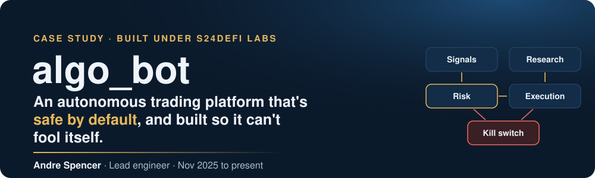
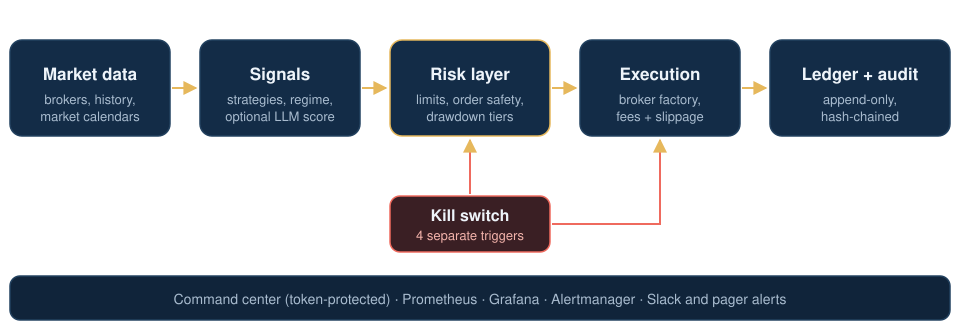
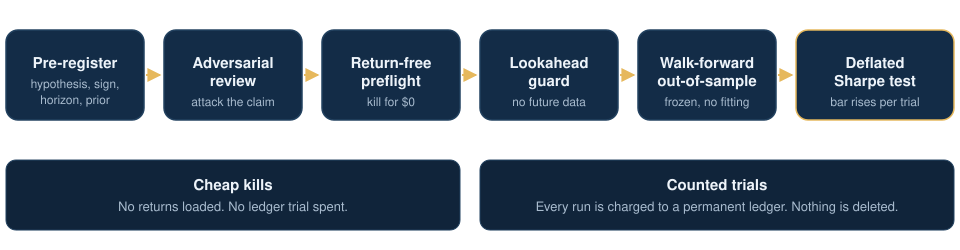
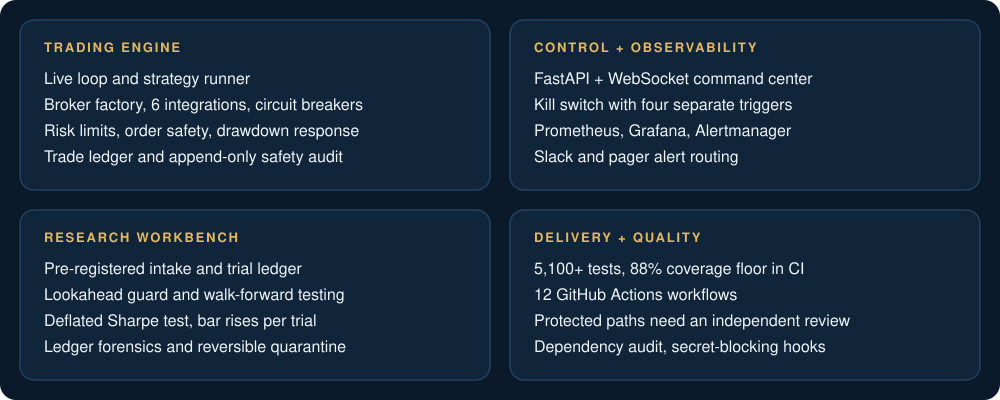

  

&nbsp;&nbsp;&nbsp;
 
&nbsp;&nbsp;&nbsp;&nbsp;

 

**Most trading bots fail quietly. This one is built to say no first.** 
*A case study in safety design, research rigor and AI-assisted engineering. Architecture and decisions, not the code.*

 

 

## Why it exists

A backtest that was luck. A bug that peeked at tomorrow's data. Fees nobody modeled. A loop that kept trading after it should have stopped. Those are the four ways retail algorithmic trading usually fails, and AI coding agents make most of them easier to commit: an agent can write a strategy, a backtest and a dashboard in an afternoon, and hand you a beautiful equity curve that is pure overfitting.

algo_bot is the opposite bet. Its first job is to refuse all of that. Its second job is to trade.

## The trading path

| Layer | What's there |
|---|---|
| **Runtime** | Python 3.11 services in a six-container Docker Compose stack: trading engine, FastAPI and WebSocket command center, an analytics dashboard, Prometheus, Alertmanager and Grafana |
| **Brokers** | Five venue integrations across crypto, US equities and FX (four with a live path), plus a paper broker, behind one factory interface with per-broker circuit breakers and position reconciliation |
| **Risk** | Per-trade, open-risk, daily-loss and losing-streak limits; order rate, size and duplicate checks; a drawdown response that shrinks, then flattens and halts |
| **Audit** | An append-only store that refuses updates and deletes, plus hash-chained risk decisions, so tampering shows |

## Seven decisions, and the failure each one prevents

| | Failure it prevents | What we built | Result |
|---|---|---|---|
| **1** | One wrong config flag puts real money at risk | Paper and testnet by default. No broker places a live order without an explicit setting; the equities path also needs a same-day confirmation file, an optional typed confirmation and a six-criteria paper-trading qualification | The safe state is the one you get by doing nothing |
| **2** | The only off switch runs inside the broken part | A kill switch with four separate triggers: file, environment, automatic loss and safety trips, and a command-center call | No trigger depends on a strategy behaving |
| **3** | Test enough ideas and one looks brilliant by chance | A permanent trial ledger and a Deflated Sharpe test; rejected ideas keep counting, so the bar rises with every idea tried | The strongest result on record was refused, and we agree with it |
| **4** | Future data leaks into a signal and nobody notices | A test that re-scores truncated history and demands identical results before any evaluation counts | It caught a real leak in a first implementation |
| **5** | The polluted rows outnumber the real ones | Signature-based cohort scoring and a reversible quarantine: 1,392 replay rows separated from 301 live paper trades | Zero misclassified rows, nothing deleted |
| **6** | AI agents that can merge anything eventually will | Separate agent roles, a strict human authorization grammar, and protected paths that need an independent review | Every protected change gets a second, independent review |
| **7** | "Ask an LLM if this trade is good" is easy to build and hard to trust | An optional LLM score, off by default and log-only until the data shows it predicts outcomes | As shipped, the score is only recorded; it blocks nothing, and if it fails, trading carries on |

## How an idea earns the right to trade

<b>The rules behind the pipeline</b> (click to expand)

 

- **Pre-registration.** Hypothesis, expected sign, one test horizon and a published prior are committed before any data is touched.
- **Return-free preflight.** Data provenance, overlap with ideas already killed, coverage and a statistical-power check, each with a kill line written in advance.
- **Cheap kills first.** At least five ideas were stopped before spending a single counted trial.
- **One trial means one trial.** No quiet sensitivity runs and no retries under a new name. A changed idea is a new registration.
- **Humans authorize every step.** Agents can propose, attack and implement, but they can't spend a trial or ship a strategy on their own.

### Results, honestly

**0 of 32** evaluations certified for capital so far. One candidate was positive in every out-of-sample fold and about three times stronger than anything before it, and it still failed the deflated bar once every earlier trial was counted. Saying no is the product. We make no claims of returns or profitability.

## System map

<b>Delivery and quality checks</b> (click to expand)

 

- ~180K lines of Python and 5,100+ automated tests, with an 88% coverage floor enforced in CI
- 12 GitHub Actions workflows, including lint and format checks and a changelog requirement on every pull request
- A dependency vulnerability audit that fails on any finding
- Pre-commit hooks that block private keys and env files
- A daily data-verification job
- 560+ merged pull requests since November 2025

<b>What this repo intentionally leaves out</b> (click to expand)

 

The algo_bot source is private. This repo holds only the case study. It leaves out strategy logic and parameters; research ideas, constructions and thresholds; risk, fee and drawdown settings; symbols, data sources and vendors; prompts and model configuration; infrastructure identifiers and secrets; and performance, P&L and account data.

## What's next

A prospective-only test: future candidates are judged on data that didn't exist when they were registered, so no past result can be rescued by a rule change. On the engineering side, the priority is fewer features, finished properly: the path from research verdict to paper deployment comes before anything new.

 

**Andre Spencer** · Senior Full-Stack Engineer · lead engineer on algo_bot

&nbsp;&nbsp;

A live walkthrough of the codebase is available on request. © 2026 S24DeFi Labs. All rights reserved. Experimental research software; not investment advice.

